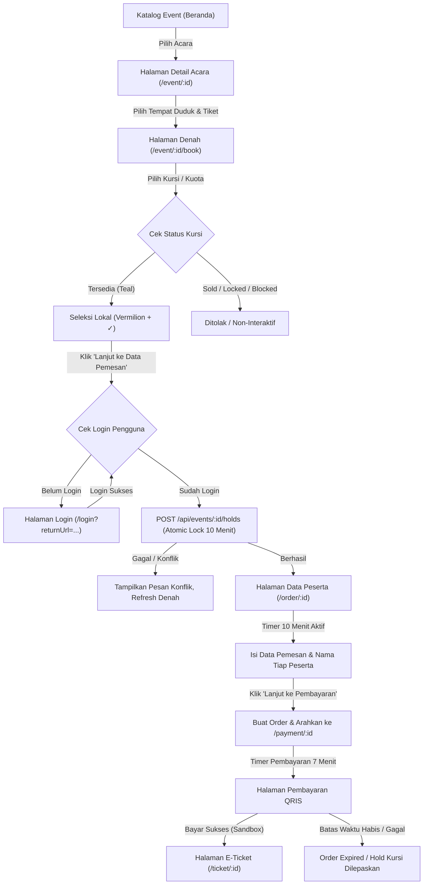
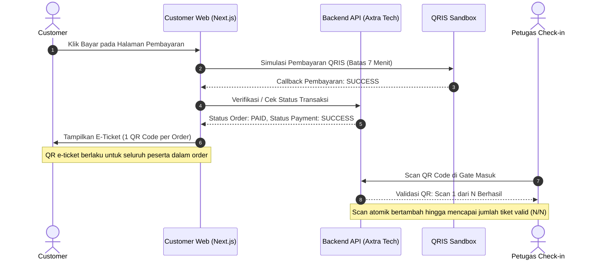

# Laporan Progres, Pembaruan, dan Alur Sistem
## Event Ticketing & Venue Management System — Customer Web
**Rujukan Utama:** `FIX DOKUMEN ANALISIS AWAL SISTEM_104621.pdf` & `AGENT_GUIDE_FINAL_v4_Flow_Denah_API-Terkunci.md`  
**Repositori:** `summarecon-ticketing-customer-side` (Next.js 16 + React 19 + Turbopack)  
**Lingkungan API:** `https://summarecon-admin.axtra.tech/api` (Live Backend Terkunci)  
**Tanggal Update:** 7 November 2026

---

## 1. Ringkasan Eksekutif

Aplikasi sisi pelanggan (*Customer Interface*) untuk **Summarecon Mall Bandung Event Ticketing** telah disesuaikan secara menyeluruh agar sejalan dengan spesifikasi dokumen analisis awal sistem dan panduan implementasi flow denah.

Seluruh aliran data telah bermigrasi **100% ke Live API**, menggantikan data statis/dummy lama. Arsitektur denah interaktif, reservasi atomik (*seat hold*), pengisian data multi-peserta, simulasi pembayaran QRIS, e-ticket 1 QR per order, serta manajemen perubahan data peserta dan refund telah selesai dibangun dan diverifikasi.

### Status Kesiapan Sistem

| Modul / Fitur | Status Dokumen Analisis | Status Implementasi | Keterangan Verifikasi |
|---|---|---|---|
| **Katalog & Detail Event** | Bab 5.1 & 7.2 | Selesai (100%) | Fetch live `GET /api/events`, harga dinamis dari kategori, banner pembatalan event |
| **Denah 3 Venue (Seat Map)** | Bab 3.3, 6.1, 6.2 | Selesai (100%) | Book by Seat, Book by Quota, dan Standing sesuai denah Atrium Cibadak, Downtown Walk, Sawarga Courtyard |
| **Atomic Seat Hold (10 Menit)** | Bab 6.2 #6, Bab 10 | Selesai (100%) | Hold atomik hanya dipicu saat klik "Lanjut" via `POST /api/events/:id/holds`, countdown aktif di halaman order |
| **Data Pemesan & Peserta** | Bab 6.2 #3-#4, 6.5 | Selesai (100%) | Data pemesan 1x per order (prefilled via `GET /api/auth/me`), nama peserta individual per tiket |
| **Pembayaran QRIS (7 Menit)** | Bab 7.3, 8.2, 11.1 | Selesai (100%) | QR code QRIS, timer 7 menit, pemisahan status Order vs Payment, tombol simulator dan cek status |
| **E-Ticket 1 QR per Order** | Bab 6.3 #6-#10, 8.6 | Selesai (100%) | Satu QR token untuk seluruh tiket dalam order, scan counter `x/y`, validasi tiket aktif |
| **Manajemen Peserta (H-1)** | Bab 6.5 #1-#5 | Selesai (100%) | Perubahan nama mandiri di `/account/orders/[id]` dikunci jika waktu kurang dari 24 jam sebelum acara |
| **Pengajuan Refund Peserta** | Bab 6.4, 7.4, 8.5 | Selesai (100%) | Pengajuan mandiri sebelum H-1 dengan data Bank/E-Wallet lengkap, status bertingkat |
| **Refund Pembatalan Event** | Bab 6.4 #5-#10, 7.6 | Selesai (100%) | Banner event dibatalkan, denah non-interaktif (`DISABLED_EVENT_CANCELLED`), form pengisian rekening pengembalian dana |
| **Riwayat & Profil Pengguna** | Bab 5.1, Bab 8.1 | Selesai (100%) | Halaman `/account/orders`, `/account/orders/[id]`, `/account/profile` terhubung auth cookie |

---

## 2. Pembaruan dan Refactoring yang Dilakukan

### A. Eliminasi Mock & Migrasi Live API Penuh
- **Pembersihan Seeder**: Menghapus script inisialisasi dummy data (`seed`, file dummy JSON lokal).
- **Service Layer Terintegrasi**: [`src/data/customer.ts`](file:///c:/Project-Web/summarecon-ticketing-customer-side/src/data/customer.ts) dan [`src/services/customerApi.ts`](file:///c:/Project-Web/summarecon-ticketing-customer-side/src/services/customerApi.ts) sepenuhnya melakukan HTTP fetch ke endpoint upstream.
- **Koneksi Jaringan Windows IPv6 Fix**: Menambahkan `dns.setDefaultResultOrder("ipv4first")` di [`next.config.ts`](file:///c:/Project-Web/summarecon-ticketing-customer-side/next.config.ts). Hal ini menyelesaikan kendala `500 Internal Server Error` akibat timeout IPv6 Cloudflare di sistem operasi Windows.

### B. Denah Interaktif Data-Driven 3 Venue
- Komponen [`VenueRenderer.tsx`](file:///c:/Project-Web/summarecon-ticketing-customer-side/src/components/seat-map/VenueRenderer.tsx) dibangun dengan koordinat normalisasi (`normalized_percent` 0–100%):
  - **Atrium Cibadak (80 Kursi Bernomor)**: 8 baris × 10 kolom, panggung atas, gate masuk/keluar, FOH, check-in, dan akses darurat.
  - **Downtown Walk (0 Kursi / Standing & Kuota Murni)**: Kotak section Standing A, Standing B, Standing C, dan Reserved Quota Q1 dilengkapi progress bar ketersediaan dan stepper kuota.
  - **Sawarga Courtyard (Mixed / Hybrid)**: Area panggung outdoor, 12 kursi belakang (Rear Seat), Standing Pit S1, dan Quota Side Q1.
- Event `EVT-SWG-001` (status `CANCELLED`): Seluruh denah dinonaktifkan otomatis dengan garis putus-putus abu-abu dan status `DISABLED_EVENT_CANCELLED`, disertai banner pembatalan acara.

### C. Restrukturisasi Booking Store & Flow Hold
- **Seleksi Lokal**: Memilih kursi di denah hanya mengubah state lokal (warna berganti dari Teal `#1F8F7E` ke Vermilion `#D93A2F` dengan tanda centang). Tidak ada request jaringan prematur dan tidak menggunakan Socket.IO.
- **Atomic Hold pada "Lanjut"**: Ketika tombol *Lanjut ke Data Pemesan* ditekan:
  1. Sistem memverifikasi sesi login pengguna (redirect ke `/login?returnUrl=...` jika belum login).
  2. Memanggil `POST /api/events/:id/holds` dengan payload `{ user_id, event_seat_ids }`.
  3. Memulai countdown timer 10 menit hanya setelah hold berhasil dibuat.
  4. Menyimpan data hold ke `sessionStorage` untuk ketahanan saat refresh halaman.

### D. Pembangunan Halaman Baru di Folder `/account`
Sebelumnya halaman akun belum tersedia di proyek Next.js. Telah dibuat:
1. [`src/app/account/layout.tsx`](file:///c:/Project-Web/summarecon-ticketing-customer-side/src/app/account/layout.tsx) — Wrapper menggunakan `MainSiteLayout` (Header navigasi dengan nama user & Footer).
2. [`src/app/account/orders/page.tsx`](file:///c:/Project-Web/summarecon-ticketing-customer-side/src/app/account/orders/page.tsx) — Daftar riwayat pesanan pelanggan dengan indikator status, jumlah tiket, ringkasan scan gate, dan tautan e-ticket.
3. [`src/app/account/orders/[id]/page.tsx`](file:///c:/Project-Web/summarecon-ticketing-customer-side/src/app/account/orders/[id]/page.tsx) — Detail pesanan dengan grid 4 status (Order, Payment, Refund, Perubahan Nama), formulir perubahan nama peserta (aturan H-1), dan formulir refund bank/e-wallet.
4. [`src/app/account/profile/page.tsx`](file:///c:/Project-Web/summarecon-ticketing-customer-side/src/app/account/profile/page.tsx) — Profil sesi pelanggan dari `fetchMe()` dan tombol keluar aman (*logout*).

### E. Standardisasi Bahasa & Style Guide
- Dibuat [`src/lib/status-mapper.ts`](file:///c:/Project-Web/summarecon-ticketing-customer-side/src/lib/status-mapper.ts) dan komponen [`StatusBadge.tsx`](file:///c:/Project-Web/summarecon-ticketing-customer-side/src/components/ui/StatusBadge.tsx) untuk memetakan seluruh enum backend ke Bahasa Indonesia resmi (misal: `SALES_OPEN` ➔ "Tiket Tersedia", `PAID` ➔ "Terbayar", `ISSUED` ➔ "Tiket Terbit").
- Utilitas waktu WIB dan perhitungan batas H-1 terpusat di [`src/lib/time-utils.ts`](file:///c:/Project-Web/summarecon-ticketing-customer-side/src/lib/time-utils.ts).

---

## 3. Alur Sistem Lengkap (System Flow)

Berdasarkan *Dokumen Analisis Awal Sistem* Bab 7 dan implementasi frontend:

### 3.1 Alur Pemesanan Tiket (Customer Booking Flow)



### 3.2 Alur Pembayaran & E-Ticket (Payment & Attendance)



### 3.3 Alur Pengajuan Refund & Pembatalan Acara

```mermaid
flowchart TD
    subgraph Refund Mandiri Peserta
        R1["Customer buka /account/orders/:id"] --> R2{"Cek Batas Waktu H-1"}
        R2 -->|"< 24 Jam Sebelum Acara"| R3["Tombol Nonaktif (Melewati Batas H-1)"]
        R2 -->|">= 24 Jam Sebelum Acara"| R4["Buka Modal Pengajuan Refund"]
        R4 --> R5["Isi Metode (Transfer Bank / E-Wallet), Nomor & Nama Pemilik Rekening"]
        R5 --> R6["Kirim Pengajuan (Status: Menunggu Persetujuan Admin)"]
        R6 --> R7["Admin Review & Transfer Manual"]
        R7 --> R8["Status Selesai (Tiket Nonaktif dari Check-in)"]
    end

    subgraph Refund Pembatalan Event
        E1["Event Dibatalkan oleh Admin"] --> E2["Status Acara: CANCELLED"]
        E2 --> E3["Denah Menjadi Transparan & Putus-Putus (DISABLED_EVENT_CANCELLED)"]
        E3 --> E4["Banner Pembatalan Muncul di Detail Acara & Halaman Tiket"]
        E4 --> E5["Customer Masuk ke Form Kelengkapan Rekening Refund"]
        E5 --> E6["Dana Dikembalikan 100% Tanpa Potongan Administrasi"]
    end
```



---

## 4. Aturan Bisnis yang Ditegakkan (Enforced Business Rules)

Sesuai Bab 6 & 11 pada *Dokumen Analisis Awal Sistem*:

1. **Aturan Kursi & Kapasitas**:
   - **Maksimal Tiket per Order**: Dibatasi maksimal 4 tiket dalam satu transaksi.
   - **Pencegahan Double Booking**: Kursi yang sedang di-hold pengguna lain (`LOCKED`) atau telah terjual (`SOLD`) tidak dapat dipilih.
   - **Kapasitas Standing & Kuota**: Dihitung dari `terpakai = terjual + tertahan` terhadap kuota maksimal.
2. **Durasi Timer**:
   - **Seat Hold**: Tepat 10 menit (600 detik). Timer hanya berjalan setelah pengguna menekan tombol *Lanjut* dan server mengonfirmasi pembuatan hold.
   - **Pembayaran Pending**: Tepat 7 menit (420 detik) pada halaman QRIS.
3. **Aturan Batas Waktu H-1 (24 Jam)**:
   - Dihitung tepat 24 jam sebelum `start_at` acara berdasarkan zona waktu lokal venue (WIB / GMT+7).
   - Pengubahan nama peserta maupun pengajuan refund mandiri ditolak secara otomatis oleh antarmuka jika batas H-1 telah terlampaui.
4. **Satu QR E-Ticket per Order**:
   - Satu order multi-tiket hanya menerbitkan satu QR code e-ticket.
   - Counter scan menampilkan rasio `successful_scan_count / valid_ticket_count`.
   - Tiket yang telah direfund otomatis memotong kuantitas valid pada QR code tersebut.

---

## 5. Dokumentasi API Change Request (ACR)

Sesuai aturan *Zona API Terkunci*, frontend tidak mengubah endpoint backend, namun mencatat penyesuaian (*workaround*) yang aman di sisi UI:

| Kode ACR | Endpoint Terkait | Isu Kontrak API yang Diamati | Penanganan Aman di Sisi Frontend |
|---|---|---|---|
| **ACR-01** | `POST /api/events/:id/holds` | Backend meminta parameter `event_seat_ids` dan `user_id` (bukan `seat_ids` angka murni). | [`customerApi.ts`](file:///c:/Project-Web/summarecon-ticketing-customer-side/src/services/customerApi.ts) mengirimkan field `event_seat_ids` dan fallback `seat_ids`. |
| **ACR-02** | `GET /api/customer/orders/:id` | Rute detail order spesifik menghasilkan `404 Not Found` (endpoint belum di-mount di backend). | Mengambil order terkait melalui filter pada daftar pesanan `GET /api/customer/orders`. |
| **ACR-03** | `POST /api/orders` | Endpoint pembuatan pesanan baru menghasilkan `404 Not Found`. | Frontend melakukan fallback lokal ke `sessionStorage` (`summa_active_order`) agar simulasi checkout dan pembayaran sandbox tetap dapat dituntaskan. |
| **ACR-04** | `POST /api/customer/refunds` | Endpoint penerimaan refund menghasilkan `404 Not Found`. | Frontend menampilkan UI konfirmasi sukses dan memperbarui state lokal order menjadi `UNDER_REVIEW`. |

---

## 6. Verifikasi & Pengujian Kode

- **TypeScript Compilation**:
  ```bash
  npx tsc --noEmit
  # Hasil: Exit code 0 (0 error)
  ```
- **Linter (Next.js ESLint)**:
  ```bash
  npm run lint
  # Hasil: Exit code 0 (0 error, 0 warning)
  ```
- **Pengujian Endpoint Live**:
  - `GET /api/events?status=SALES_OPEN` ➔ **200 OK** (1 Event Atrium Cibadak)
  - `GET /api/events/EVT-ATR-001` ➔ **200 OK** (Detail Acara Atrium Cibadak)
  - `GET /api/events/EVT-ATR-001/seats` ➔ **200 OK** (80 kursi denah Cibadak)
  - `GET /api/events/EVT-SWG-001` ➔ **200 OK** (Event Sawarga Courtyard - `CANCELLED`)
  - `GET /api/events/EVT-DWT-001` ➔ **200 OK** (Event Downtown Walk - `COMPLETED`)
  - `GET /api/auth/me` ➔ **401 UNAUTHENTICATED** (Penanganan respons otentikasi normal)

---
*Laporan ini disimpan di berkas [`docs/PROGRES_DAN_ALUR_SISTEM.md`](file:///c:/Project-Web/summarecon-ticketing-customer-side/docs/PROGRES_DAN_ALUR_SISTEM.md) sebagai dokumentasi acuan tim pengembang.*

