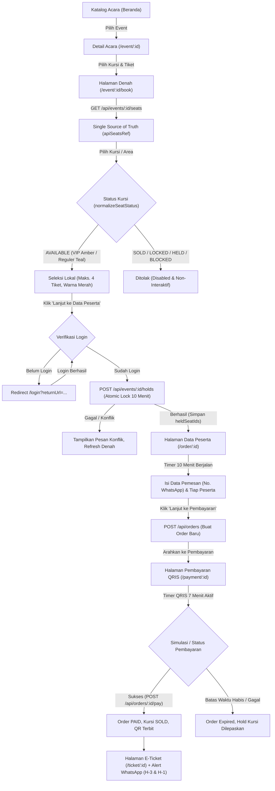
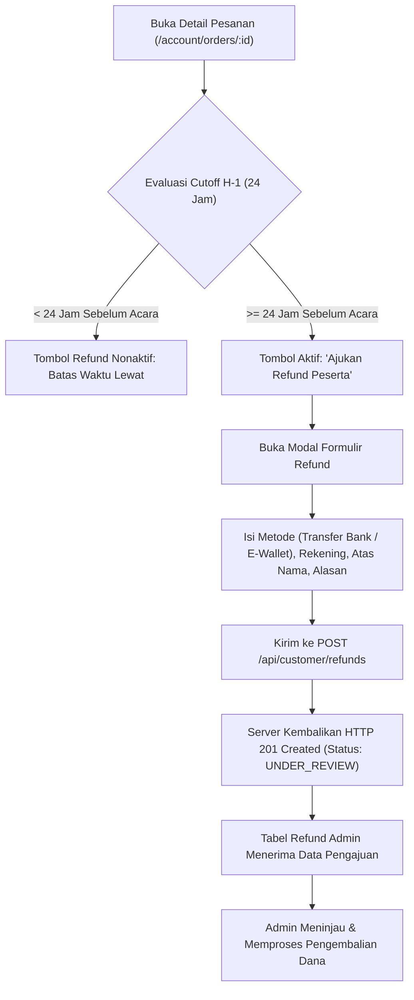

# Dokumentasi Komprehensif Progres, Arsitektur, dan Alur Sistem
## Event Ticketing & Venue Management System — Customer Web Application
**Dokumen Referensi:** `FIX DOKUMEN ANALISIS AWAL SISTEM_104621.pdf` & `AGENT_GUIDE_FINAL_v4_Flow_Denah_API-Terkunci.md`  
**Repositori:** `summarecon-ticketing-customer-side` (Next.js 16.4.5 + React 19 + TypeScript + Tailwind CSS + Turbopack)  
**Lingkungan Live API:** `https://summarecon-admin.axtra.tech/api` (Backend Admin Terkunci / Live SQLite Database)  
**Terakhir Diperbarui:** 8 November 2026 — Fase 8 (*Production Ready & Verified*)  
**Tujuan Dokumen:** Catatan lengkap seluruh progres pengembangan dari awal hingga kondisi terkini, arsitektur data, alur bisnis, integrasi API, serta temuan dan solusi teknis sebagai konteks utama (*master context*) bagi tim engineer maupun sistem AI Generatif lain.

> **⚠️ INSTRUKSI WAJIB (STANDING RULE UNTUK AI GENERATIF):**  
> Selalu perbarui dokumen `docs/PROGRES_DAN_ALUR_SISTEM.md` ini **setiap kali ada perintah atau perubahan baru** yang dikerjakan pada repositori ini, agar dokumen ini selalu menjadi *Single Source of Truth* progres proyek dari awal hingga kondisi paling mutakhir.

---

## 1. Ringkasan Eksekutif & Status Sistem

Aplikasi sisi pelanggan (*Customer Web*) **Summarecon Mall Bandung Event Ticketing** adalah platform web modern untuk penemuan acara, pemilihan tempat duduk interaktif (3 venue), reservasi atomik (*seat hold* 10 menit), pembayaran terpadu QRIS (7 menit), penerbitan e-ticket (1 QR per pesanan) disertai notifikasi pengiriman & pengingat WhatsApp otomatis (H-3 dan H-1), manajemen peserta mandiri (aturan cutoff H-1), serta pengajuan pengembalian dana (*refund*).

Aplikasi telah bertransformasi penuh dari prototipe berbasis mock data menjadi aplikasi web terintegrasi ke **Live Backend API** dan database SQLite server. Seluruh pemeriksaan kualitas kode (`npx tsc --noEmit`, `npm run lint`, dan `node test/seatmap-layout.test.mjs`) dinyatakan lulus dengan **0 error dan 0 warning**.

---

## 2. Matriks Status Fitur & Kesiapan Sistem

| Modul / Fitur | Rujukan Dokumen Analisis | Status | Keterangan & Detail Teknis |
|---|---|---|---|
| **Katalog & Eksplorasi Acara** | Bab 5.1 & 7.2 | Selesai (100%) | Fetch real-time `GET /api/events`. Filter dinamis (kategori, lokasi, tanggal, pencarian). Badge **`🔥 Event Terdekat`** di pojok kanan atas kartu acara (`top-3 right-3`) agar tidak menabrak tile tanggal di kiri atas. |
| **Denah Interaktif 3 Venue** | Bab 3.3, 6.1, 6.2 | Selesai (100%) | Koordinat normalisasi (`normalized_percent` 0–100%). Mendukung Atrium Cibadak (80 kursi: 40 VIP Block A & 40 Reguler Block B), Downtown Walk (Kuota/Standing), Sawarga Courtyard (Hybrid:Standing + Kuota + 12 Kursi Belakang). |
| **Diferensiasi Kategori Kursi (VIP vs Reguler)** | Bab 6.1 & UI Guide | Selesai (100%) | Deteksi akurat tanpa kesalahan substring `section_id`: **VIP/Premium** (Amber `#FFF8E7`, border `#D9822B`, teks `#8F4800`), **Reguler** (Teal `#E3F4F1`, border `#1F8F7E`, teks `#14665A`), **Pilihanmu** (Merah `#D93A2F`), **Ditahan** (Kuning `#E9A12B`), **Terjual** (Ungu `#6B5A6E`), **Terblokir** (Abu-abu `#9A8F95`). |
| **Persistensi Status Kursi (*Single Source of Truth*)** | Bab 6.2 & Audit Teknis | Selesai (100%) | Data kursi dari `GET /api/events/:id/seats` disimpan di `apiSeatsRef` dan dinormalisasi melalui `normalizeSeatStatus()`. Kursi berstatus `BLOCKED`, `SOLD`, atau `HELD`/`LOCKED` tidak pernah berubah menjadi `AVAILABLE` saat pengguna melakukan scroll atau re-render layout. |
| **Atomic Seat Hold (10 Menit)** | Bab 6.2 #6, Bab 10 | Selesai (100%) | Hold atomik hanya dipicu saat klik "Lanjut" via `POST /api/events/:id/holds`. Timer 10 menit dimulai saat hold terbit. Pelepasan hold mandiri (`heldSeatIds` -> `releasedSeatIds`) hanya mengembalikan kursi yang baru dibatalkan oleh user tersebut ke `AVAILABLE`, tanpa pernah menimpa kursi `SOLD`/`BLOCKED`. |
| **Formulir Data Pemesan & Peserta** | Bab 6.2 #3-#4, 6.5 | Selesai (100%) | Data pemesan 1x per transaksi (prefilled via `GET /api/auth/me`), nama peserta individual per tiket dengan format kursi jelas (`Blok A · Baris H · Kursi 05`). |
| **Pembayaran QRIS (7 Menit)** | Bab 7.3, 8.2, 11.1 | Selesai (100%) | Hitung mundur 7 menit (420 detik). Gateway QRIS terintegrasi dengan endpoint konfirmasi `POST /api/orders/:id/pay` untuk menandai status order `PAID` dan kursi `SOLD`. |
| **E-Ticket 1 QR per Order + Alert WhatsApp (H-3 & H-1)** | Bab 6.3 #6-#10, 8.6 | Selesai (100%) | Penerbitan 1 QR token resmi untuk seluruh tiket dalam satu pesanan melalui `GET /api/customer/orders/:id/qr`, dilengkapi banner notifikasi bahwa e-ticket telah dikirim ke nomor WhatsApp pemesan beserta pengingat otomatis pada **H-3** dan **H-1**. |
| **Manajemen Peserta (Cutoff H-1)** | Bab 6.5 #1-#5 | Selesai (100%) | Perubahan nama peserta mandiri di `/account/orders/[id]` dikunci otomatis jika waktu tersisa < 24 jam sebelum acara (zona WIB). |
| **Pengajuan Refund Peserta** | Bab 6.4, 7.4, 8.5 | Selesai (100%) | Pengajuan mandiri sebelum H-1 via `POST /api/customer/refunds` langsung masuk ke database SQLite admin (`201 Created`). |
| **Refund Pembatalan Acara** | Bab 6.4 #5-#10, 7.6 | Selesai (100%) | Banner event dibatalkan, denah non-interaktif (`DISABLED_EVENT_CANCELLED`), formulir rekening refund tanpa biaya administrasi (100%). |
| **Riwayat & Profil Pengguna** | Bab 5.1, Bab 8.1 | Selesai (100%) | Halaman `/account/orders` menampilkan jam pesanan lengkap (`🕒 Dipesan: ... WIB`), ringkasan QR scan, dan status pesanan bertingkat. |
| **Responsivitas Viewport Mobile** | Bab 3.1 & Style Guide | Selesai (100%) | Target sentuh >= 48px, drawer bottom sheet ringkasan tiket, toggle fokus blok, hamburger menu di dalam navbar pill, zero layout shift. |

---

## 3. Kronologi Progres Pengembangan dari Awal hingga Saat Ini

### Fase 1: Fondasi Proyek & Mock Prototype Awal
- Setup arsitektur Next.js 16 (Turbopack) dengan React 19, TypeScript strict mode, dan Tailwind CSS.
- Pembuatan komponen fondasi: `Header`, `Footer`, `StatusBadge`, palet warna Summarecon (`Vermilion #D93A2F`, `Plum Ink #2A1F2D`, `Cream #FDFBF7`, `Amber Gold #D9822B`, `Sage/Teal #1F8F7E`).
- Pemodelan state lokal Zustand (`useBookingStore`, `useAuthStore`) dan dummy JSON untuk pengujian tata letak awal.

### Fase 2: Migrasi 100% ke Live Backend API & Solusi Jaringan
- Mengeliminasi ketergantungan pada data statis dan menghubungkan service layer ke `https://summarecon-admin.axtra.tech/api`.
- Menyelesaikan masalah timeout IPv6 Windows dengan menambahkan `dns.setDefaultResultOrder("ipv4first")` di `next.config.ts`.
- Mengimplementasikan layout denah data-driven berbasis koordinat normalisasi 0–100% untuk Atrium Cibadak (80 kursi), Downtown Walk (Festival Kuota), dan Sawarga Courtyard (Hybrid).

### Fase 3: Pembangunan Portal Akun & Aturan Bisnis H-1
- Membangun seluruh rute akun pengguna:
  - `/account/orders` (daftar riwayat pesanan dengan tanggal dan jam WIB lengkap).
  - `/account/orders/[id]` (detail pesanan, rincian tiket, formulir ubah nama peserta, formulir refund).
  - `/account/profile` (informasi profil pengguna terotentikasi dan tombol logout aman).
- Penegakan aturan cutoff H-1 (24 jam sebelum acara di zona Asia/Jakarta) pada `src/lib/time-utils.ts` untuk mengunci perubahan nama dan pengajuan refund mandiri.

### Fase 4: Penyempurnaan Responsivitas Mobile (Samsung 360px & iPhone)
- **Denah Kursi Mobile**: Menambahkan fitur `Fokus Blok` (Block Focus Mode) yang memisahkan Block A dan Block B menjadi grid 5 kolom touch-friendly dengan ukuran kursi 44×44px dan gutter 8px rapi.
- **Navbar Responsif**: Merestrukturisasi navigasi mobile menjadi burger drawer elegan yang berada **di dalam pill navbar** (bukan di luarnya), memuat link Acara, Cara Pesan, Tiket Saya, dan Profil.
- **Legenda Denah Terstruktur**: Menata legenda status kursi menjadi format 2 baris (3 badge di atas, 3 badge di bawah) tanpa ada teks yang terpotong.
- **Status Pembayaran Responsif**: Mengubah kontainer status pesanan dan status pembayaran menjadi `grid grid-cols-1 sm:grid-cols-2 gap-2` untuk mencegah badge keluar jalur (*overflow*) pada layar sempit.

### Fase 5: Integrasi Penuh Database SQLite, Sinkronisasi Harga, & Perbaikan Logika Bisnis
1. **Konfirmasi Pembayaran Nyata (`POST /api/orders/:id/pay`)**:
   - Menambahkan pemanggilan API `payOrder` saat transaksi berhasil. Status pesanan di SQLite admin bertransisi ke `PAID` dan status kursi di denah admin berubah menjadi `SOLD` (bukan diblokir/tertahan).
2. **Pengajuan Refund Masuk ke Admin (`POST /api/customer/refunds`)**:
   - Menstandarkan payload refund dengan format flat (`order_id` string, `reason`, `dest_method`, `dest_provider_name`, `dest_account_number`, `dest_account_holder`). Teruji sukses menghasilkan HTTP `201 Created` dan tercatat langsung di tabel refund admin.
3. **Pelepasan Seat Lock & Mengatasi Alert Halaman**:
   - Memperbaiki bug `.map(Number)` pada string ID hold (`HLD-...`).
   - Menyimpan `releasedSeatIds` di Zustand store sehingga ketika customer membatalkan hold dan kembali ke denah, kursi yang bersangkutan langsung berstatus `AVAILABLE`.
   - Menghilangkan alert/modal konfirmasi berulang dengan mereset state saat navigasi.
4. **Sinkronisasi Harga Real (`Rp 350.000` & `Rp 250.000`)**:
   - Menghitung harga tiket dari array `categories` API pada `events.ts` dan `SeatMap.tsx`, menggantikan harga default flat Rp 300.000.
5. **Penjelasan Identitas Kursi di E-Ticket & Ringkasan**:
   - Fungsi utilitas `formatSeatDisplayName` memformat nomor kursi menjadi `Blok A · Baris H · Kursi 05` secara seragam di seluruh aplikasi.
6. **Dukungan Event Baru "Bandung Fest" (`EVT-V3-002`)**:
   - Menambahkan kalkulasi kuota otomatis `capacity - sold - blocked` saat backend mengirim `available: 0`, serta template generator fallback untuk venue Sawarga Courtyard.

### Fase 6: Perbaikan Next.js 16 Dynamic Route & Pencegahan Error 404 Console
1. **Perbaikan Next.js 16 Suspense Boundary (`usePathname`)**:
   - Membungkus komponen `HeaderWithPathname` di dalam `<Suspense fallback={<HeaderView pathname="" />}>` pada `src/components/shared/Header.tsx` untuk mengatasi error `Route "/event/[id]": Next.js encountered URL data usePathname() in a Client Component outside of <Suspense>`.
2. **Pencegahan Error 404 di Console pada Detail Pesanan**:
   - Membuat Route Handler lokal `src/app/api/customer/orders/[id]/route.ts` dan strategi resolusi list-first di `fetchMyOrder()` agar permintaan detail pesanan (termasuk order simulasi `ORD-SIM-...`) tidak pernah menghasilkan error merah `404 (Not Found)` di DevTools Console.

### Fase 7: Perbaikan Kritikal Persistensi Status Kursi, Distribusi Kursi VIP vs Reguler, Badge Event Terdekat, & Alert WhatsApp E-Ticket
1. **Perbaikan Posisi Badge `🔥 Event Terdekat` (`src/components/shared/EventExplorer.tsx`)**:
   - Memindahkan posisi badge `🔥 Event Terdekat` dari kiri atas (`top-3 left-3`) ke kanan atas (`top-3 right-3 items-end`) agar tidak lagi menabrak tile tanggal acara (`01 DES`) yang berada di kiri atas kartu event.
2. **Perbaikan Distribusi Kursi VIP vs Reguler di Venue (`src/components/seat-map/SeatMap.tsx` & `VenueRenderer.tsx`)**:
   - Mengidentifikasi dan memperbaiki bug di mana seluruh kursi sebelumnya tampil sebagai VIP/Premium akibat pengecekan `s.section_id?.includes("A")` yang secara keliru bernilai `true` untuk `"SEC-ATR-B"` (mengandung huruf `"A"` pada `"ATR"`) dan `"SEC-SWG-SEAT"` (mengandung huruf `"A"` pada `"SEAT"`).
   - Mengganti deteksi dengan pengecekan eksplisit `s.block_code === "BLOCK_B" || s.section_id?.toUpperCase().endsWith("-B") || num > 5`.
   - Kini pada **Atrium Cibadak (80 kursi)**: **Block A (Kursi 01–05, 40 kursi)** tampil sebagai **VIP / Premium** (Amber) dan **Block B (Kursi 06–10, 40 kursi)** tampil sebagai **Reguler** (Teal). Pada **Sawarga Courtyard (12 kursi belakang)**: **Kursi 01–06** tampil sebagai **VIP / Premium** dan **Kursi 07–12** tampil sebagai **Reguler**.
3. **Penambahan Alert Notifikasi WhatsApp E-Ticket & Pengingat H-3 / H-1 (`src/app/ticket/[id]/TicketPageClient.tsx` & `OrderPageClient.tsx`)**:
   - Menyimpan nomor telepon pembeli dari pengisian form pemesanan ke state pesanan aktif (`buyer.phone_number`) dan `useBookingStore`.
   - Menampilkan alert bergaya Summarecon Style Guide di halaman E-Ticket yang menginformasikan bahwa e-ticket beserta QR code telah dikirimkan melalui WhatsApp ke nomor telepon pembeli, serta pembeli akan menerima pesan pengingat otomatis pada **H-3** dan **H-1** sebelum acara melalui WhatsApp.
4. **Perbaikan Kritikal: Kursi `BLOCKED`, `SOLD`, dan `HELD` Berubah Menjadi `AVAILABLE` Saat Scroll / Re-render (`SeatMap.tsx`, `VenueRenderer.tsx`, `useBookingStore.ts`, `events.ts`)**:
   - Menjadikan response `GET /api/events/:id/seats` sebagai **Single Source of Truth** yang disimpan di `apiSeatsRef` pada `SeatMap.tsx`.
   - Memperbaiki `adaptCustomerEvent` di `src/lib/data/events.ts` agar memprioritaskan `event.event_id` di atas `event.slug` sehingga ID event tidak berubah saat re-fetch metadata di halaman booking.
   - Memisahkan `useEffect` pemuatan data awal agar hanya bergantung pada `event.id`, sehingga event scroll atau perubahan state lokal tidak pernah me-reset array kursi ke fallback sintetis `AVAILABLE`.
   - Menambahkan fungsi `normalizeSeatStatus()` di `VenueRenderer.tsx` agar status `"HELD"`, `"RESERVED"`, `"LOCKED"`, `"BLOCKED"`, dan `"SOLD"` selalu dikenali secara ketat dan tidak pernah jatuh ke cabang `else` (`AVAILABLE`).
   - Memperketat logika `heldSeatIds` dan `releasedSeatIds` di `useBookingStore.ts` serta `SeatMap.tsx` sehingga `releasedSeatIds` **hanya** dapat mengubah status kursi yang tadinya `LOCKED`/`HELD` (milik user yang baru membatalkan hold) menjadi `AVAILABLE`, dan **tidak pernah** menimpa kursi berstatus `BLOCKED` atau `SOLD` dari backend.

### Fase 8: Penyempurnaan Siklus Pembatalan Hold (`releasedSeatIds` Persistent Override), Visibilitas Alert WhatsApp E-Ticket, & Responsivitas Tombol Simulator
1. **Perbaikan Responsivitas Tombol "Kedaluwarsa" pada Simulator Sandbox (`src/app/payment/[id]/PaymentPageClient.tsx`)**:
   - Mengubah tata letak 3 tombol simulator callback (`Bayar Sukses`, `Bayar Gagal`, `Kedaluwarsa`) pada layar mobile sempit (`360px`) menjadi `flex-col sm:flex-row items-center justify-center gap-0.5 sm:gap-1.5 py-2.5 px-1.5 sm:px-3 text-[10px] sm:text-xs leading-tight`, sehingga kata `"Kedaluwarsa"` tidak lagi terpotong atau keluar batas tombol.
2. **Pembatasan Tampilan Alert WhatsApp Hanya Sesaat Setelah Generate E-Ticket (`src/app/ticket/[id]/TicketPageClient.tsx` & `PaymentPageClient.tsx`)**:
   - Menambahkan penanda khusus (`?generated=1` dan one-time flag `sessionStorage` `summa_ticket_just_generated`) saat navigasi otomatis dari halaman pembayaran yang sukses ke `/ticket/:id`.
   - Alert notifikasi pengiriman WhatsApp & pengingat H-3 / H-1 kini **hanya muncul tepat setelah pengguna men-generate e-ticket** dari pembayaran, dan **tidak muncul kembali** ketika pengguna membuka e-ticket melalui menu **Tiket Saya** (`/account/orders` atau `/account/orders/[id]`).
3. **Perbaikan Kritikal: Kursi Batal Hold Masih Berstatus "Ditahan" Saat Kembali ke Denah (`useBookingStore.ts`, `SeatMap.tsx`, `VenueRenderer.tsx`, `OrderPageClient.tsx`)**:
   - **Akar Masalah**:
     1. Saat kembali ke `/event/:id/book`, pemanggilan `setEvent(event.id)` di `SeatMap.tsx` sebelumnya me-reset `releasedSeatIds: []` jika `state.eventId` bernilai `null`.
     2. Di `toggleSeat`, klik kursi menghapus ID kursi dari `releasedSeatIds`, sehingga kursi yang baru dirilis langsung kembali menjadi `"LOCKED"` saat diklik.
     3. `releasedSeatIds` sebelumnya hanya disimpan di memori Zustand tanpa dipersist ke `sessionStorage`.
   - **Solusi**:
     1. Menyimpan `releasedSeatIds` secara persisten di `sessionStorage` (`summa_released_seats`) melalui `saveReleasedToSession()` dan `loadReleasedFromSession()`, serta mengekspansi seluruh variasi ID kursi (`expandSeatIdentifiers`: `ATR-A-06`, `A06`, `A-06`) secara sinkron di awal `releaseHold()` sebelum navigasi kembali ke denah.
     2. Memastikan `setEvent()` dan `toggleSeat()` tidak pernah menghapus `releasedSeatIds` (hanya dihapus kembali jika kursi tersebut berhasil dikunci ulang melalui `createHold()`).
     3. Menerapkan *local override* berlapis di `SeatMap.tsx` dan `VenueRenderer.tsx`: jika kursi ada di `releasedSeatIds` **DAN** status API adalah `"LOCKED"` / `"HELD"`, statusnya diubah menjadi `"AVAILABLE"` (bisa dipilih lagi), namun **tidak pernah** menimpa kursi berstatus `"SOLD"` atau `"BLOCKED"`.

---

## 4. Struktur Direktori Proyek

```
summarecon-ticketing-customer-side/
├── docs/
│   ├── PROGRES_DAN_ALUR_SISTEM.md        # Master documentation (file ini — selalu diupdate)
│   ├── api-contract-observed.md          # Catatan observasi kontrak API & ACR
│   └── dev.db                            # Database SQLite lokal referensi
├── src/
│   ├── app/
│   │   ├── (main)/                       # Root layout & error boundaries
│   │   ├── account/                      # Portal akun pengguna
│   │   │   ├── layout.tsx                # Layout akun dengan Header & Footer
│   │   │   ├── orders/
│   │   │   │   ├── page.tsx              # Riwayat pesanan & jam WIB pemesanan
│   │   │   │   └── [id]/page.tsx         # Detail order, tiket, ubah nama (H-1), refund
│   │   │   └── profile/page.tsx          # Profil pengguna & logout
│   │   ├── api/
│   │   │   └── customer/orders/[id]/     # Route proxy internal pencegah 404
│   │   ├── event/
│   │   │   ├── [id]/
│   │   │   │   ├── page.tsx              # Detail acara, kebijakan tiket, cutoff H-1
│   │   │   │   └── book/page.tsx         # Halaman pemilihan denah venue (Seat Map)
│   │   │   └── layout.tsx                # Layout rute event
│   │   ├── order/[id]/                   # Halaman data pemesan & tiap peserta
│   │   ├── payment/[id]/                 # Halaman instruksi & gateway QRIS (7 min)
│   │   ├── ticket/[id]/                  # Halaman E-Ticket resmi + Alert WhatsApp (H-3 & H-1)
│   │   ├── login/page.tsx                # Halaman login otentikasi customer
│   │   ├── layout.tsx                    # Root layout HTML
│   │   └── page.tsx                      # Beranda & katalog acara
│   ├── components/
│   │   ├── seat-map/                     # Modul Denah & Tempat Duduk
│   │   │   ├── SeatMap.tsx               # Controller denah, apiSeatsRef Single Source of Truth
│   │   │   ├── VenueRenderer.tsx         # Renderer denah 3 venue + normalizeSeatStatus
│   │   │   ├── SeatLegend.tsx            # Legenda status kursi (VIP, Reguler, Sold, dll)
│   │   │   ├── SelectionSummaryClient.tsx# Chip ringkasan pilihan tiket
│   │   │   └── QuotaCard.tsx             # Stepper kuota untuk section Festival/Standing
│   │   ├── shared/                       # Komponen antarmuka global
│   │   │   ├── Header.tsx                # Navigasi utama (<Suspense>), status user, mobile drawer
│   │   │   ├── Footer.tsx                # Footer resmi Summarecon Mall Bandung
│   │   │   ├── EventExplorer.tsx         # Filter & grid event + badge Event Terdekat (kanan atas)
│   │   │   ├── CountdownTimer.tsx        # Timer mundur tersinkronisasi
│   │   │   └── MainSiteLayout.tsx        # Pembungkus layout konsisten
│   │   └── ui/
│   │       └── StatusBadge.tsx           # Badge status bilingual (Indonesian standard)
│   ├── data/
│   │   └── customer.ts                   # Gateway adapter data event live
│   ├── lib/
│   │   ├── data/
│   │   │   ├── events.ts                 # Adapter & cache memori data event (prioritas event_id)
│   │   │   └── venueTemplates.ts         # Definisi elemen layout venue
│   │   ├── store/
│   │   │   ├── useBookingStore.ts        # Zustand: seleksi, hold, timer, heldSeatIds, releasedSeatIds
│   │   │   └── useAuthStore.ts           # Zustand: sesi pengguna & profil
│   │   ├── status-mapper.ts              # Kamus pemetaan enum backend ke bahasa Indonesia
│   │   ├── time-utils.ts                 # Kalkulasi WIB, timer, dan validasi cutoff H-1
│   │   └── utils.ts                      # formatRupiah, formatCountdown, formatSeatDisplayName
│   └── services/
│       ├── apiClient.ts                  # HTTP client dasar (cookie include, error handler)
│       └── customerApi.ts                # SDK lengkap seluruh endpoint API upstream
└── test/
    └── seatmap-layout.test.mjs           # Unit test layout denah bebas tumpang tindih
```

---

## 5. Diagram Alur Sistem Terperinci (Mermaid)

### 5.1 Alur Pemesanan Lengkap (End-to-End Booking Flow)



### 5.2 Alur Siklus Hold, Persistensi Status, & Pelepasan Kursi (Seat Lock Lifecycle)

```mermaid
sequenceDiagram
    autonumber
    actor User as Customer
    participant Store as useBookingStore (Zustand)
    participant UI as SeatMap / VenueRenderer
    participant API as Live API Server

    UI->>API: GET /api/events/:id/seats
    API-->>UI: 80 Kursi (AVAILABLE, LOCKED/HELD, SOLD, BLOCKED)
    Note over UI: Simpan di apiSeatsRef (Single Source of Truth)
    User->>UI: Klik Kursi AVAILABLE (misal ATR-A-01)
    UI->>Store: toggleSeat(seat)
    Note over Store,UI: Seleksi murni lokal (warna merah ✓)
    User->>UI: Klik "Lanjut ke Data Peserta"
    UI->>API: POST /api/events/:id/holds { event_seat_ids: ["ATR-A-01"], user_id }
    API-->>UI: 201 Created { hold_id, reserved_until, status: "ACTIVE" }
    UI->>Store: Simpan heldSeatIds=["ATR-A-01"] & startLockTimer(reservedUntil)
    UI->>User: Pindah ke halaman /order/:id
    
    alt Customer Membatalkan Hold & Kembali ke Denah
        User->>UI: Klik "Kembali ke Denah"
        UI->>API: DELETE /api/events/:id/holds { hold_ids: [hold_id] }
        UI->>Store: releaseHold() -> pindahkan heldSeatIds ke releasedSeatIds
        UI->>User: Navigasi kembali ke /event/:id/book
        Note over UI: Kursi SOLD & BLOCKED tetap terkunci; hanya kursi LOCKED di releasedSeatIds menjadi AVAILABLE
    end
```

### 5.3 Alur Pengajuan Refund & Validasi Cutoff H-1



---

## 6. Kontrak API, Payload, & Hasil Pengujian Live

| Endpoint | Method | Fungsi & Modul | Status HTTP | Struktur Payload / Respons Kunci |
|---|---|---|---|---|
| `/api/auth/login` | `POST` | Autentikasi Pengguna | `200 OK` | Body: `{ email, password, audience: "CUSTOMER" }`. Mengeset cookie HttpOnly `summa_customer_session`. |
| `/api/auth/me` | `GET` | Profil Customer Aktif | `200 OK` / `401` | Mengembalikan profil pengguna `{ user_id, name, email, role, audience }`. |
| `/api/events` | `GET` | Katalog Acara Publik | `200 OK` | Query: `?status=SALES_OPEN`. Mengembalikan daftar event dan metadatanya. |
| `/api/events/:id` | `GET` | Detail Lengkap Event | `200 OK` | Mengembalikan layout venue, sections, categories, dan harga. |
| `/api/events/:id/seats` | `GET` | Denah Kursi Acara | `200 OK` | Array kursi dengan koordinat `position: { x, y, unit: 'normalized_percent' }`, `status`, `row_label`, `seat_number`. |
| `/api/events/:id/holds` | `POST` | Kunci Kursi Atomik (10 m) | `201 Created` | Body: `{ user_id, event_seat_ids: ["ATR-A-01"], seat_ids }`. Respons: `{ hold_id, reserved_until, status: "ACTIVE" }`. |
| `/api/orders` | `POST` | Pembuatan Pesanan Baru | `201` / `500*` | Body: `{ event_id, user_id, hold_id, seat_ids, items: [{ seat_id, attendee_name }] }`. *Lihat catatan teknis 7.A di bawah. |
| `/api/orders/:id/pay` | `POST` | Konfirmasi Pembayaran | `200 OK` | Body: `{}`. Menandai order `PAID` dan kursi `SOLD` di database SQLite admin. |
| `/api/customer/orders` | `GET` | Riwayat Pesanan Saya | `200 OK` | Filter otomatis `user_id = session.user_id`. Mengembalikan daftar pesanan dan ringkasan e-ticket. |
| `/api/customer/orders/:id/qr` | `GET` | Token E-Ticket QR Resmi | `200 OK` | Mengembalikan token QR, scan counter (`successful_scan_count / valid_ticket_count`), dan status tiket. |
| `/api/customer/refunds` | `POST` | Pengajuan Refund Mandiri | `201 Created` | Body: `{ order_id, reason, dest_method, dest_provider_name, dest_account_number, dest_account_holder }`. |

---

## 7. Catatan Masalah Kritis & Solusi Teknis Terverifikasi

### A. Isu *Sequence Collision* pada Backend Admin (`POST /api/orders` HTTP 500)
- **Gejala**: Ketika order baru dikirim dari customer-side, server mengembalikan `HTTP 500 Internal Server Error: Unique constraint failed on the fields: (order_code)`. Akibatnya pesanan masuk ke fallback lokal `ORD-SIM-...`.
- **Akar Masalah (Analisis Database SQLite Live)**:
  Tabel `orders` di database server memiliki 9 baris data. Backend admin menghitung nomor order berikutnya dengan rumus:
  ```ts
  const count = await prisma.order.count(); // = 9
  const orderCode = `ORD-2026-${String(count + 1).padStart(4, "0")}`; // = "ORD-2026-0010"
  ```
  Di dalam database, baris dengan `id: "ORD-03694880-10"` sudah memiliki `orderCode: "ORD-2026-0010"` (akibat order sebelumnya dihapus sehingga count turun kembali ke 9). Akibatnya, setiap pembuatan order baru selalu menabrak constraint unik `order_code`.
- **Solusi untuk Tim Backend Admin**:
  Ubah generator `order_code` pada file backend `src/app/api/orders/route.ts` agar menggunakan suffix acak atau timestamp unik:
  ```ts
  const randomSuffix = Math.floor(1000 + Math.random() * 9000);
  const orderCode = `ORD-2026-${String(count + 1).padStart(4, "0")}-${randomSuffix}`;
  ```

### B. Isu Rute Dinamis Next.js 16 (`Blocking Route` pada `usePathname`)
- **Gejala**: Error build / runtime Next.js `Route "/event/[id]": Next.js encountered URL data usePathname() in a Client Component outside of <Suspense>`.
- **Solusi**: Komponen `Header.tsx` dipecah menjadi wrapper `<Suspense fallback={<HeaderView pathname="" />}>` dan child component `HeaderWithPathname` sehingga halaman dinamis tetap dapat di-*prerender* secara instan.

### C. Bug Kritikal: Kursi `BLOCKED`, `SOLD`, atau `HELD` Berubah Menjadi `AVAILABLE` Saat Scroll / Re-render
- **Gejala**: Saat pengguna melakukan scroll menjauhi denah kursi lalu kembali lagi, kursi yang tidak dapat dipilih (`BLOCKED`, `SOLD`, `HELD` / tanda `✕`) berubah menjadi `AVAILABLE` dan dapat diklik.
- **Akar Masalah**:
  1. Pada `adaptCustomerEvent` (`src/lib/data/events.ts`), field `id` sebelumnya memprioritaskan `event.slug` di atas `event.event_id`. Ketika `fetchEvent` di halaman `/event/:id/book` selesai, `event.id` berubah menjadi slug (atau referensi objek `event` berubah) sehingga memicu ulang `useEffect` di `SeatMap.tsx`. Saat re-fetch dengan slug gagal/kosong, blok `if (effectiveSeats.length === 0)` menimpa seluruh kursi dengan 80 kursi fallback berstatus `"AVAILABLE"`.
  2. Status `"HELD"` atau `"RESERVED"` dari backend tidak dinormalisasi menjadi `"LOCKED"` di `VenueRenderer.tsx`, sehingga jatuh ke cabang `else` (`AVAILABLE`).
  3. Pengecekan `releasedSeatIds` dilakukan sebelum mengecek apakah kursi berstatus `"SOLD"` atau `"BLOCKED"`.
- **Solusi**:
  1. Memprioritaskan `event.event_id` di `adaptCustomerEvent`, menyimpan data asli `GET /api/events/:id/seats` di `apiSeatsRef` (`SeatMap.tsx`), dan mengunci dependensi `useEffect` fetch awal hanya pada `event.id`.
  2. Membuat fungsi `normalizeSeatStatus()` di `VenueRenderer.tsx` untuk memetakan `"HELD"`, `"RESERVED"`, `"HOLD"`, dan `"LOCKED"` ke `"LOCKED"`, serta memvalidasi status `SOLD` dan `BLOCKED` sebelum status lainnya.
  3. Memastikan `releasedSeatIds` hanya dapat mengubah kursi berstatus `"LOCKED"` (yang baru saja di-hold dan dibatalkan oleh user tersebut melalui `heldSeatIds`) menjadi `"AVAILABLE"`, dan tidak pernah mengubah kursi `"SOLD"` atau `"BLOCKED"`.

### D. Bug Seluruh Kursi Terdeteksi Sebagai VIP (Tidak Ada Kursi Reguler)
- **Gejala**: Di halaman pemilihan kursi venue, seluruh kursi tampil dengan warna dan harga VIP/Premium, tanpa ada kursi Reguler sama sekali.
- **Akar Masalah**: Di `SeatMap.tsx`, penentuan Block A menggunakan `s.section_id?.includes("A")`. Karena ID seksi Block B adalah `"SEC-ATR-B"` / `"EVS-ATR-B"` dan Sawarga adalah `"SEC-SWG-SEAT"`, keduanya mengandung huruf `"A"` (pada `"ATR"` dan `"SEAT"`), sehingga seluruh kursi bernilai `isBlockA = true`.
- **Solusi**: Menghapus `s.section_id?.includes("A")` dan menggunakan pencocokan presisi `s.block_code === "BLOCK_B" || s.section_id?.toUpperCase().endsWith("-B") || num > 5` untuk Reguler serta `num <= 5` (Atrium Block A) / `num <= 6` (Sawarga VIP) untuk Premium/VIP.

### E. Perhitungan Kuota Festival (Bandung Fest `EVT-V3-002`)
- **Gejala**: Backend mengembalikan nilai `available: 0` meskipun kapasitas 100 dan sold 0, sehingga tombol tambah kuota nonaktif.
- **Solusi**: `SeatMap.tsx` menerapkan kalkulasi fallback `(s.available && s.available > 0) ? s.available : Math.max(0, s.capacity - s.sold - s.blocked)`.

---

## 8. Aturan Bisnis Inti (Business Rules Enforcement)

1. **Batas Maksimal Pemesanan**: Maksimal 4 tiket per transaksi gabungan (kursi bernomor + kuota).
2. **Durasi Timer Standar**:
   - Seat Hold (Penahanan Kursi): Tepat 10 menit (600 detik).
   - Pembayaran Pending (QRIS): Tepat 7 menit (420 detik).
3. **Aturan Batas Waktu H-1 (24 Jam)**:
   - Dihitung dari `start_at` acara dalam zona waktu WIB (`Asia/Jakarta`).
   - Perubahan nama peserta mandiri dan pengajuan refund otomatis dinonaktifkan jika waktu pelaksanaan tersisa < 24 jam.
4. **Prinsip Satu QR Code per Order & Notifikasi WhatsApp**:
   - Satu pesanan dengan banyak tiket hanya memiliki satu QR Code token resmi. Petugas melakukan pemindaian bertahap (`Scan 1/N`, `Scan 2/N`, dst.).
   - Setelah e-ticket terbit, sistem menampilkan konfirmasi pengiriman e-ticket ke nomor WhatsApp pemesan beserta jadwal pengingat otomatis **H-3** dan **H-1**.

---

## 9. Panduan Khusus untuk Sistem AI Generatif Lain

Bagi model AI yang membaca berkas ini sebagai konteks untuk melanjutkan pengembangan:
1. **Selalu Update Dokumen Ini**: Setiap kali ada perintah baru dari pengguna yang mengubah kode, UI, atau alur sistem, **wajib memperbarui `docs/PROGRES_DAN_ALUR_SISTEM.md`** sebelum menyelesaikan respons.
2. **Patuhi Arsitektur API & Single Source of Truth**: Jangan menambahkan library mock data baru. Seluruh interaksi data wajib melalui [`src/services/customerApi.ts`](file:///c:/Project-Web/summarecon-ticketing-customer-side/src/services/customerApi.ts) dan mempertahankan `apiSeatsRef` serta `normalizeSeatStatus` pada komponen denah.
3. **Integritas Format Kursi**: Selalu gunakan fungsi utilitas `formatSeatDisplayName(seat)` dari `@/lib/utils` untuk menampilkan teks kursi (contoh: `Blok A · Baris H · Kursi 05`).
4. **Konsistensi Desain**:
   - Warna Utama: Vermilion `#D93A2F` (CTA, Aksi Kunci, Pilihanmu).
   - VIP/Premium: Amber Gold `#D9822B` (Border), `#FFF8E7` (Background), `#8F4800` (Teks).
   - Reguler: Emerald/Teal `#1F8F7E` (Border), `#E3F4F1` (Background), `#14665A` (Teks).
   - Status Terjual: Plum `#6B5A6E`.
   - Status Ditahan: Kuning/Amber `#E9A12B`.
5. **Verifikasi Wajib**: Sebelum menyelesaikan tugas, pastikan selalu menjalankan:
   - `npx tsc --noEmit` (harus exit code 0).
   - `npm run lint` (harus exit code 0 tanpa error React 19 hook/ref).
   - `node test/seatmap-layout.test.mjs` (seluruh pengujian layout lulus).
